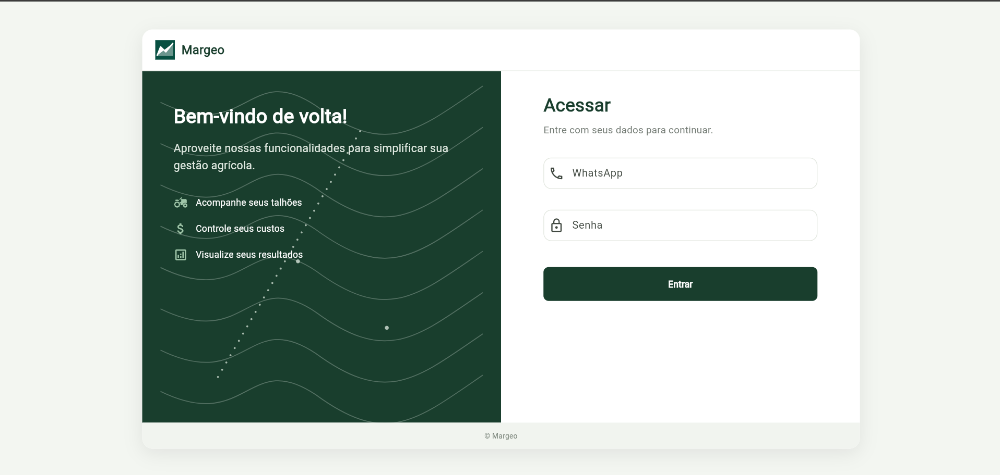
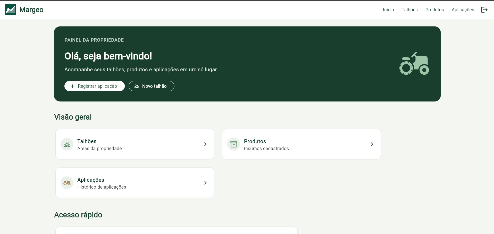
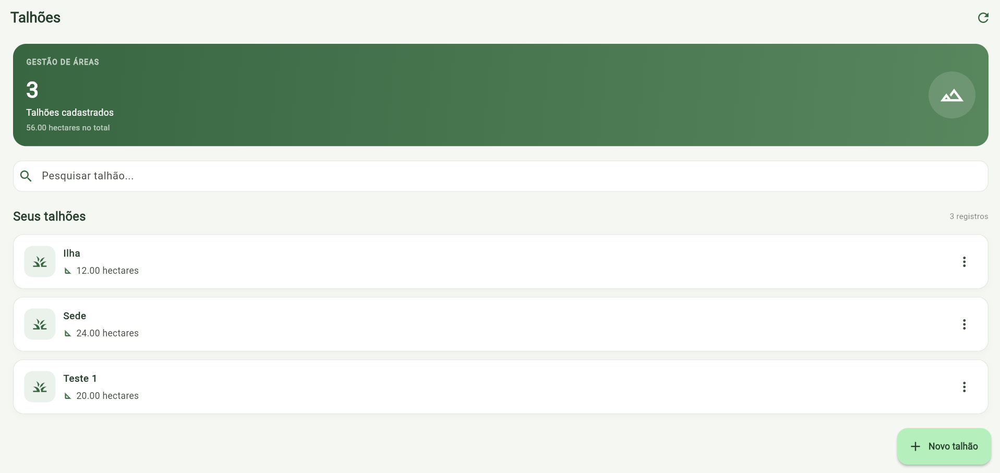
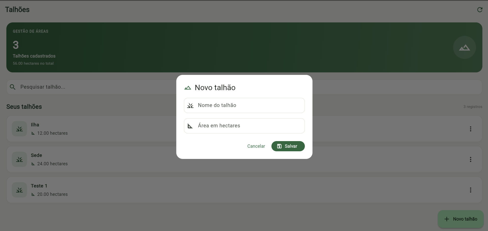
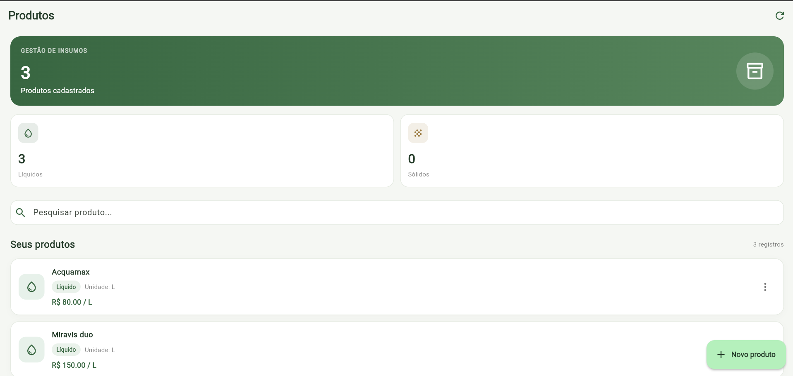
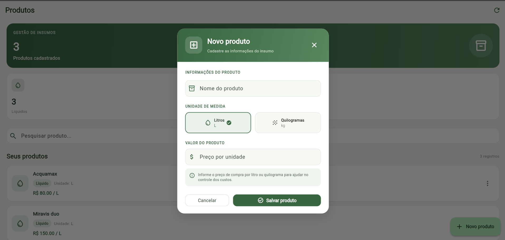
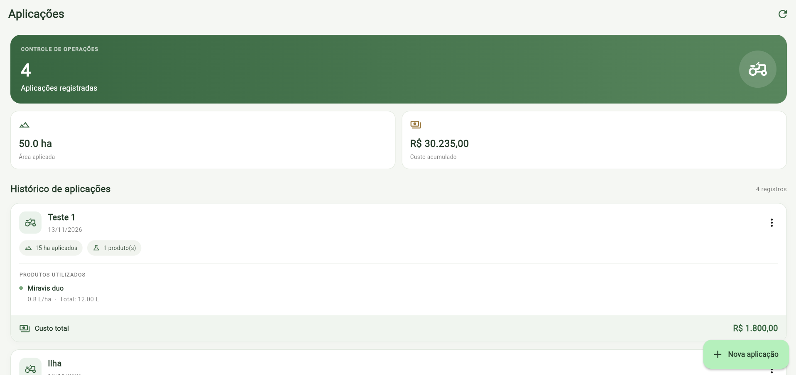
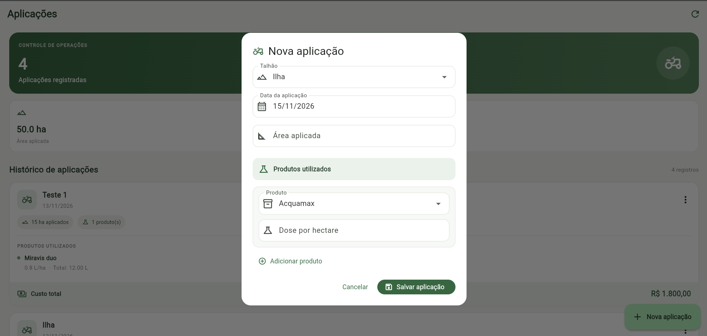

# 🌱 Margeo


Sistema de gestão agrícola desenvolvido para auxiliar produtores rurais no controle de talhões, produtos, aplicações e custos por área.


O projeto busca facilitar o registro das atividades agrícolas e centralizar informações que podem se perder quando são controladas manualmente ou em planilhas.


## Objetivo


Desenvolver uma aplicação que permita registrar e acompanhar as aplicações realizadas em cada talhão, controlar os produtos utilizados e visualizar os custos relacionados à produção agrícola.


## Funcionalidades


- Autenticação de usuários por WhatsApp e senha.

- Cadastro, consulta, edição e exclusão de talhões.

- Cadastro, consulta, edição e exclusão de produtos.

- Registro e gerenciamento de aplicações agrícolas.

- Associação de aplicações aos respectivos talhões e produtos.

- Controle dos custos das aplicações.

- Armazenamento do preço do produto no momento do registro da aplicação.

- Restrição de acesso aos registros de cada usuário.


## Tecnologias utilizadas


| Tecnologia | Utilização |

|---|---|

| Flutter | Desenvolvimento da aplicação mobile |

| Dart | Linguagem de programação do aplicativo |

| Laravel | Desenvolvimento da API |

| PHP | Linguagem do backend |

| MySQL | Banco de dados |

| Laravel Sanctum | Autenticação da API |

| Docker | Containerização do ambiente |

| Nginx | Servidor web |

| Git e GitHub | Versionamento e hospedagem do código |


## Arquitetura do projeto


O projeto está organizado em duas partes principais:


- `apps/mobile`: aplicação desenvolvida em Flutter.

- `apps/api`: API desenvolvida em Laravel.


A API utiliza uma organização em camadas, separando responsabilidades entre Controllers, Requests, Models, Repositories e Services.


Essa estrutura busca facilitar a manutenção e a organização das regras de negócio.


## Estrutura de diretórios


```text

Margeo/

├── apps/

│   ├── api/

│   │   ├── app/

│   │   │   ├── Http/

│   │   │   │   ├── Controllers/

│   │   │   │   └── Requests/

│   │   │   ├── Models/

│   │   │   ├── Repositories/

│   │   │   └── Services/

│   │   ├── database/

│   │   └── routes/

│   └── mobile/

│       ├── lib/

│       └── pubspec.yaml

├── docker/

├── docs/

│   └── imagens/

├── docker-compose.yaml

├── .env.example

└── README.md

```


## Regras de negócio


O sistema possui algumas regras para garantir a consistência dos registros:


1. Cada usuário pode acessar somente seus próprios registros.

2. Uma aplicação só pode ser vinculada a talhões e produtos pertencentes ao usuário autenticado.

3. A área aplicada não pode ultrapassar a área total do talhão.

4. O preço do produto é armazenado no momento do registro da aplicação, preservando o valor utilizado no cálculo do custo.

5. As operações de criação e atualização de aplicações utilizam transações no banco de dados para manter a integridade das informações.


## API


A API disponibiliza rotas para autenticação e gerenciamento dos principais recursos do sistema.


| Método | Endpoint | Descrição |

|---|---|---|

| POST | `/api/auth/login` | Autenticação do usuário |

| GET | `/api/plots` | Listagem de talhões |

| POST | `/api/plots` | Cadastro de talhão |

| GET | `/api/products` | Listagem de produtos |

| POST | `/api/products` | Cadastro de produto |

| GET | `/api/applications` | Listagem de aplicações |

| POST | `/api/applications` | Registro de aplicação |


Também existem operações de consulta individual, atualização e exclusão para os recursos de talhões, produtos e aplicações.


## Como executar o projeto


### Pré-requisitos


- Git

- Docker Desktop

- Flutter SDK

- Navegador atualizado


### 1. Clonar o repositório


```bash

git clone https://github.com/MClaraFr/Margeo.git

cd Margeo

```


### 2. Configurar as variáveis de ambiente


Na raiz do projeto, copie o arquivo de exemplo:


```powershell

Copy-Item .env.example .env

```


Copie também o arquivo de ambiente da API:


```powershell

Copy-Item apps/api/.env.example apps/api/.env

```


No arquivo `.env` da raiz, configure as credenciais do MySQL:


```env

MYSQL_DATABASE=margeo

MYSQL_ROOT_PASSWORD=sua_senha_root

MYSQL_USER=margeo_user

MYSQL_PASSWORD=sua_senha_usuario

```


No arquivo `apps/api/.env`, configure a conexão com o banco:


```env

DB_CONNECTION=mysql

DB_HOST=mysql

DB_PORT=3306

DB_DATABASE=margeo

DB_USERNAME=margeo_user

DB_PASSWORD=sua_senha_usuario

```


O valor de `DB_PASSWORD` deve ser igual ao valor de `MYSQL_PASSWORD` configurado no arquivo `.env` da raiz.


### 3. Iniciar os containers


Na raiz do projeto, execute:


```bash

docker compose up -d --build

```


### 4. Instalar as dependências da API


```bash

docker compose exec php composer install

```


### 5. Gerar a chave da aplicação


```bash

docker compose exec php php artisan key:generate

```


### 6. Executar as migrations e seeders


```bash

docker compose exec php php artisan migrate --seed

```


Esse comando cria as tabelas do banco de dados e executa os seeders disponíveis no projeto.


### 7. Executar a aplicação Flutter


Entre na pasta do aplicativo:


```bash

cd apps/mobile

```


Instale as dependências:


```bash

flutter pub get

```


Execute no navegador:


```bash

flutter run -d chrome

```


## Endereços locais


| Serviço | Endereço |

|---|---|

| API | http://localhost:8183/api |

| phpMyAdmin | http://localhost:8185 |

| Aplicação Flutter | Executada pelo navegador após `flutter run -d chrome` |


O aplicativo seleciona automaticamente o endereço da API conforme a plataforma. No emulador Android, utiliza `http://10.0.2.2:8183/api`. Essa configuração está em `lib/core/constants/api_constants.dart`.


## Acesso de demonstração


O projeto possui um usuário de demonstração criado pelo seeder.


| Campo | Valor |

|---|---|

| WhatsApp | 42927272727 |

| Senha | Mgeo50 |


Essas credenciais são destinadas exclusivamente à demonstração local do projeto.


## Testes


Foram realizados testes automatizados na API utilizando o PHPUnit.


Última execução registrada em 15/11/2026:


- 4 testes aprovados.

- 11 asserções.

- Testes unitários e de funcionalidades.


Os testes automatizados incluem verificações relacionadas aos talhões:


- Restrição de acesso aos talhões de outros usuários.

- Cadastro de um novo talhão.


Os recursos de produtos e aplicações também foram verificados manualmente por meio de arquivos de requisição `.rest`.


Para executar os testes automatizados:


```bash

docker compose exec php php artisan test

```


## Capturas de tela


### Login





### Tela inicial





### Talhões





### Cadastro de talhão





### Produtos





### Cadastro de produto





### Aplicações





### Cadastro de aplicação





## Melhorias futuras


Como possibilidades de evolução do projeto, estão previstas:


- Integração com WhatsApp para facilitar o acesso às informações.

- Aplicação de recursos de inteligência artificial para auxiliar na análise dos dados agrícolas.

- Ampliação dos relatórios de custos e acompanhamento das atividades.


Essas funcionalidades são propostas para versões futuras e ainda não estão implementadas.


## Autoria


**Maria Clara Ferreira**


Curso: Análise e Desenvolvimento de Sistemas  

Instituição: UniGuairacá


Projeto desenvolvido no contexto das disciplinas:


- Programação para Dispositivos Móveis

- POO Web

- Paradigmas de Programação


**Repositório:** [github.com/MClaraFr/Margeo](https://github.com/MClaraFr/Margeo)


